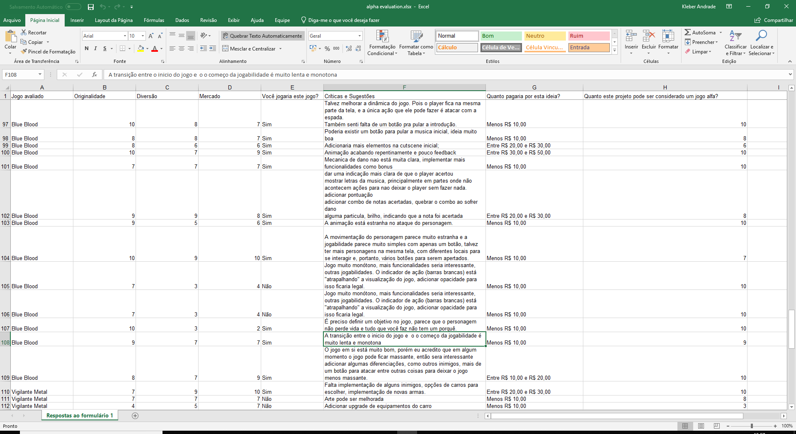
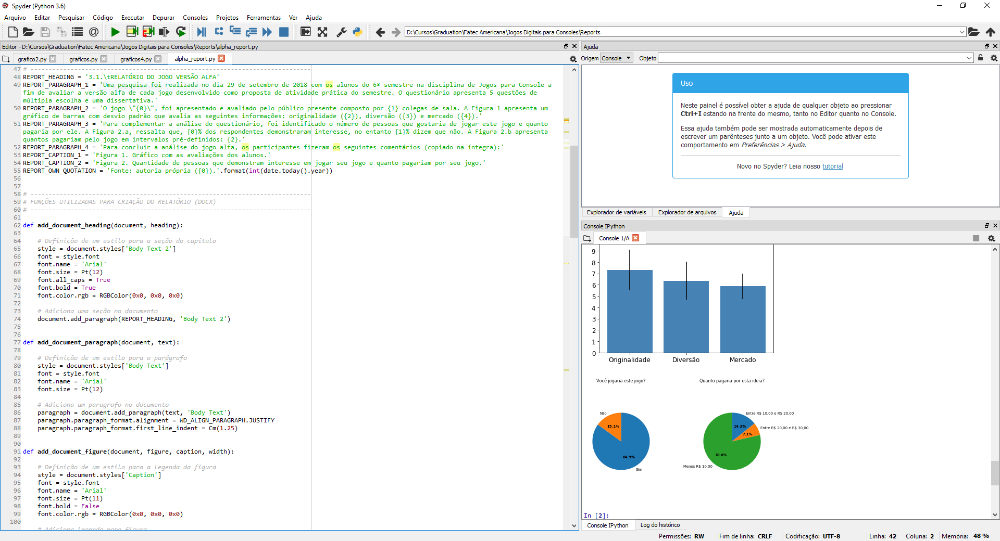
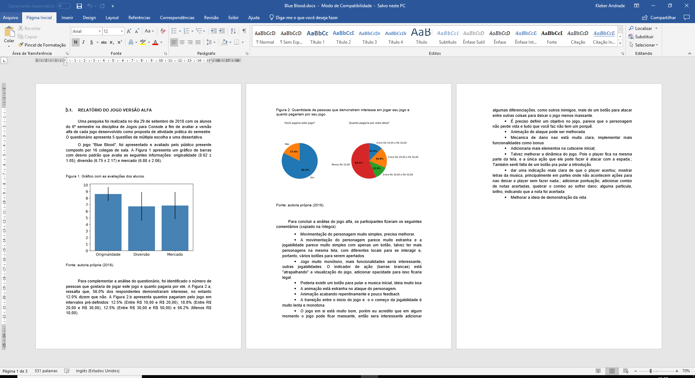

# Class Report Generator

Python scripts and sample reports for game-project evaluations using python-docx.

## Getting started

- Inspect each report script and its spreadsheet inputs before running it. Install the packages imported by the selected script in an isolated Python environment.

- The repository includes an email-sending script; configure your own credentials and recipients explicitly before choosing to use that script.

## Repository map

- [alpha evaluation.xlsx](https://github.com/kleberandrade/report-python-docx/blob/master/alpha%20evaluation.xlsx)
- [alpha_report.py](https://github.com/kleberandrade/report-python-docx/blob/master/alpha_report.py)
- [beta_report_send_email.py](https://github.com/kleberandrade/report-python-docx/blob/master/beta_report_send_email.py)

## Validation status

This update documents the tracked source and project metadata. It does not certify a successful build, device test or compatibility with a current toolchain. Follow any project-specific validation instructions in the original material.

## License and attribution

See [LICENSE](https://github.com/kleberandrade/report-python-docx/blob/master/LICENSE) and any notices accompanying third-party code and assets. This documentation update does not change licensing or authorship.

---

## Original project material

# Gerador de relatórios da aula

Códigos para geração dos relatórios (avaliação alfa, beta e final) dos jogos apresentados na disciplina de Jogos Digitais para Console do curso de Jogos Digitais (6º semestre) da [Faculdade de Tecnologia de Americana](http://www.fatec.edu.br/).  

### Arquivo .xlsx gerado pela Planilha do Google

  

### Ambiente Spyder para desenvolvimento

Instalar a biblioteca python-docx usando pip

    python -m pip install --upgrade pip
    pip install python-docx
    
Instalar a biblioteca python-docx usando conda

    conda install -c conda-forge python-docx
    conda install -c conda-forge/label/gcc7 python-docx 

  

### Arquivo .docx gerado pelo código

  

Licença
----

    Copyright 2018 Kleber de Oliveira Andrade
    
    Permission is hereby granted, free of charge, to any person obtaining a copy
    of this software and associated documentation files (the "Software"), to deal
    in the Software without restriction, including without limitation the rights
    to use, copy, modify, merge, publish, distribute, sublicense, and/or sell
    copies of the Software, and to permit persons to whom the Software is
    furnished to do so, subject to the following conditions:
    
    The above copyright notice and this permission notice shall be included in all
    copies or substantial portions of the Software.
    
    THE SOFTWARE IS PROVIDED "AS IS", WITHOUT WARRANTY OF ANY KIND, EXPRESS OR
    IMPLIED, INCLUDING BUT NOT LIMITED TO THE WARRANTIES OF MERCHANTABILITY,
    FITNESS FOR A PARTICULAR PURPOSE AND NONINFRINGEMENT. IN NO EVENT SHALL THE
    AUTHORS OR COPYRIGHT HOLDERS BE LIABLE FOR ANY CLAIM, DAMAGES OR OTHER
    LIABILITY, WHETHER IN AN ACTION OF CONTRACT, TORT OR OTHERWISE, ARISING FROM,
    OUT OF OR IN CONNECTION WITH THE SOFTWARE OR THE USE OR OTHER DEALINGS IN THE
    SOFTWARE.
